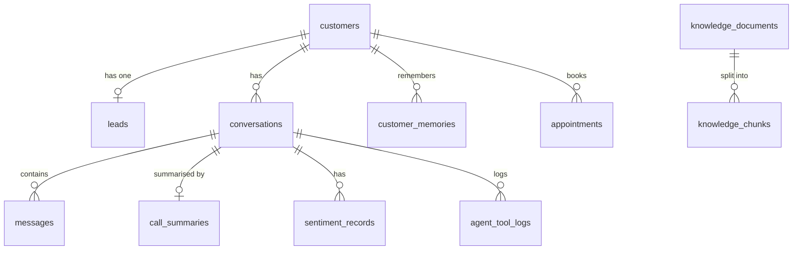

# Database design

ORM models: `backend/app/models.py`. SQLite file: `backend/data/salespilot.db`. Foreign keys are enforced (`PRAGMA foreign_keys=ON`), WAL journal for better concurrent reads.

| Table | Purpose | Key columns | Relationships / rules |
|---|---|---|---|
| `customers` | A person who talked to the agent | name, email, phone, language | Deleting a customer cascades to everything below (right to erasure) |
| `leads` | Sales view of a customer | interest, budget, timeline, authority, requirements, intent_level, **score**, **category**, status, score_breakdown, **score_reasons** | 1:1 with customer (unique FK). Indexed on score, category, status |
| `conversations` | One call/chat session | UUID id, channel (voice/text), language, status, `state` (offered slots, pending booking), `memory_summary` | UUID so customer-facing URLs are unguessable |
| `messages` | Every turn | role, content, language, intents, **sources**, **generated_by** | `generated_by` proves whether an LLM or a template wrote it |
| `customer_memories` | Long-term facts per customer | key, value, source_message_id | Unique (customer_id, key). Inspect/delete from CRM |
| `appointments` | Counselling bookings | start_time, end_time, status, topic | **Partial unique index** `uq_active_slot` on start_time WHERE status='booked' → database refuses double bookings |
| `knowledge_documents` | Uploaded files | filename (unique), status, chunk_count, error | Re-uploading a filename replaces it |
| `knowledge_chunks` | Searchable pieces | title, content, embedding (JSON, optional) | Cascade-deleted with the document |
| `call_summaries` | End-of-call report | summary, objections, interests, budget, purchase_intent, sentiment, lead_score, follow_up_action, appointment_info, generated_by | 1:1 with conversation |
| `sentiment_records` | One per customer message | label, confidence, explanation, recommended_action, objections | Feeds analytics |
| `agent_tool_logs` | Audit trail of every tool call | tool_name, input, output, success, error, duration_ms | Shown in Live agent "agent actions" |
| `app_settings` | Editable configuration | key, value (JSON) | Business profile, prompt, scoring weights, schedule, voice |

`users` table: not implemented. The MVP protects admin endpoints with an `ADMIN_API_KEY` header instead of user accounts (see SECURITY.md).

## Transactions
- Booking: validate slot → check customer has no other upcoming booking → check slot free → insert → `commit()`. If two requests race, the unique index makes the second commit fail with `IntegrityError`, which is turned into a clean "slot_taken" error (`tests/test_appointments.py::test_database_unique_index_blocks_race`).
- Reschedule uses the same index.

## Migrations and PostgreSQL path
The MVP creates tables with `Base.metadata.create_all` at startup (fine for a fresh demo DB, not for evolving production schemas). Production plan:
1. Add **Alembic**, generate the initial migration from these models.
2. `DATABASE_URL=postgresql+psycopg://…`, install `psycopg[binary]`.
3. JSON columns become `JSONB`; the partial unique index is declared for PostgreSQL too (`postgresql_where`).
4. Add `tenant_id` to every table + row-level security for multi-tenancy.
