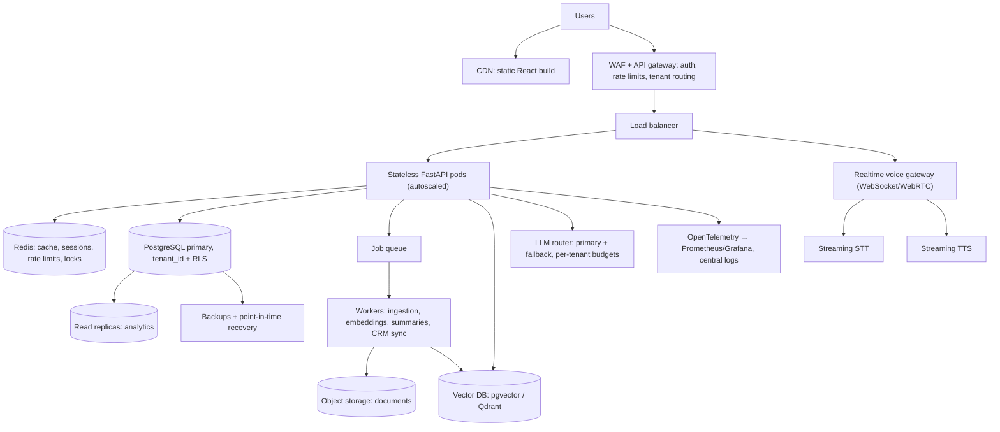

# Scaling to 100,000 registered users

## 1. Implemented vs tested vs proposed
| | Status |
|---|---|
| Single FastAPI process + SQLite + in-process BM25 index + in-memory rate limiter | **Implemented**, runs on a laptop |
| Functional tests (58 backend, 20 browser steps) | **Tested** |
| Load / concurrency / latency at scale | **Not tested**. No throughput numbers are claimed |
| Everything below | **Proposed** design |

## 2. Registered vs concurrent users
100,000 *registered* users is a storage and account problem; *concurrent* users drive compute. Planning assumption (to be validated with real traffic): 5% daily active, peak hour 15% of daily → **~750 concurrent conversations at peak**, each sending a message every ~15 s → **~50 messages/s**, and LLM calls at the same rate. Storage: 100k customers × ~20 messages × ~1 KB ≈ 2 GB/year of conversation text: small for PostgreSQL.

## 3. Production architecture

| Component | Role | Why |
|---|---|---|
| React on CDN | Static files at the edge | No servers needed for the UI |
| API gateway / WAF | TLS, auth (OIDC/JWT), per-tenant + per-IP rate limits, bot protection | Protects backend and LLM budget |
| Stateless API pods | Current FastAPI code; state moves to Postgres/Redis | Any pod can serve any request → horizontal scaling |
| Load balancer + autoscaling | Kubernetes HPA / cloud autoscaling on CPU and request rate | Handle peaks, scale to minimum at night |
| PostgreSQL | Replaces SQLite (same ORM) via Alembic migrations; read replicas for analytics | Concurrent writes, durability |
| Redis | Rate limiting, session cache, slot locks, cached analytics | Fast shared state |
| Job queue + workers | Document parsing, embeddings, summaries, webhooks run async | Keeps chat latency low |
| Object storage | Original uploaded files | Cheap, durable |
| Vector DB | pgvector (simplest: same Postgres) or Qdrant for larger corpora; HNSW index | Semantic search at scale |
| Dedicated STT/TTS | Streaming providers or self-hosted Whisper/Piper on GPU | Browser APIs don't work on phone lines or all browsers |
| LLM router | Choose model per task (small model for classification, larger for answers), fallback on errors, caching of frequent answers, token budgets per tenant | Cost + reliability |
| Observability | Request traces, LLM latency/cost per tenant, error rates, alerting | Find problems before customers do |
| Backups | Daily snapshots + WAL archiving (PITR), restore drills | Recovery |

## 4. Multi-tenant isolation
Every table gets `tenant_id`; PostgreSQL row-level security enforces it; API keys/JWT carry the tenant; knowledge bases and vector collections are per tenant; per-tenant rate limits and LLM budgets. Large customers can get a dedicated database.

## 5. Code changes needed (from today's MVP)
1. `DATABASE_URL` → PostgreSQL, add Alembic.
2. BM25 in-process index → vector DB / Postgres full-text (the in-memory index is per process).
3. In-memory rate limiter → Redis.
4. Move ingestion and summary generation to background jobs.
5. Add authentication and `tenant_id`.
6. Streaming responses (SSE/WebSocket) to cut perceived latency.

## 6. Roadmap
| Phase | Scale target | Work |
|---|---|---|
| 0 (now) | Demo, 1 business | This repo |
| 1 | Pilot, ~1k users | Postgres, Alembic, auth, HTTPS deploy (Render/Railway/Fly free tiers or a small VM), Sentry, backups |
| 2 | ~10k users | Redis, background workers, pgvector, CI/CD, load tests (Locust/k6) with real numbers |
| 3 | 100k users, multi-tenant | Kubernetes/managed containers, autoscaling, LLM router, streaming voice gateway, RLS, SLOs |
