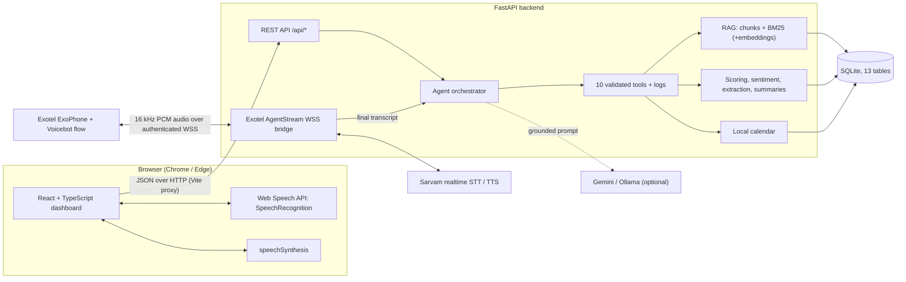
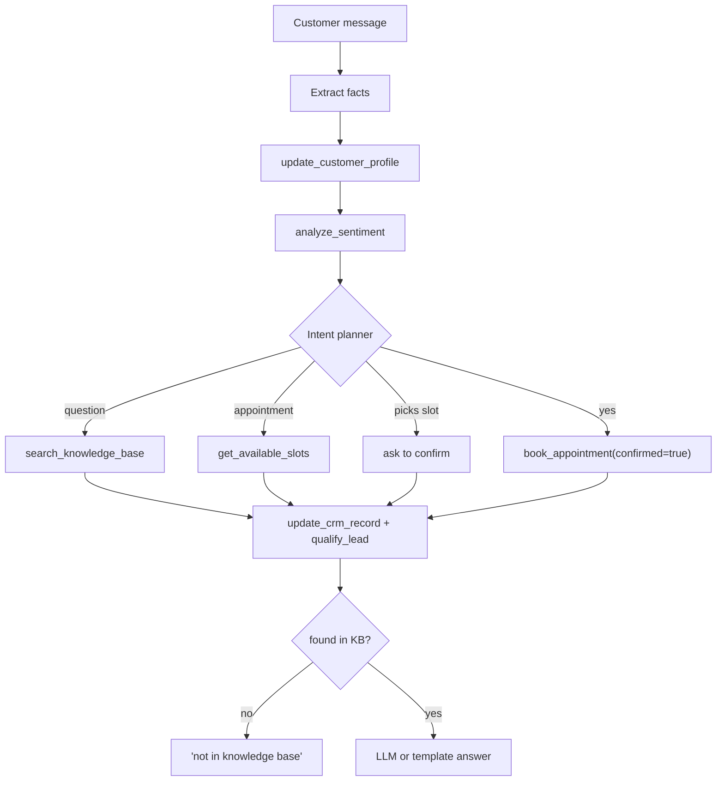
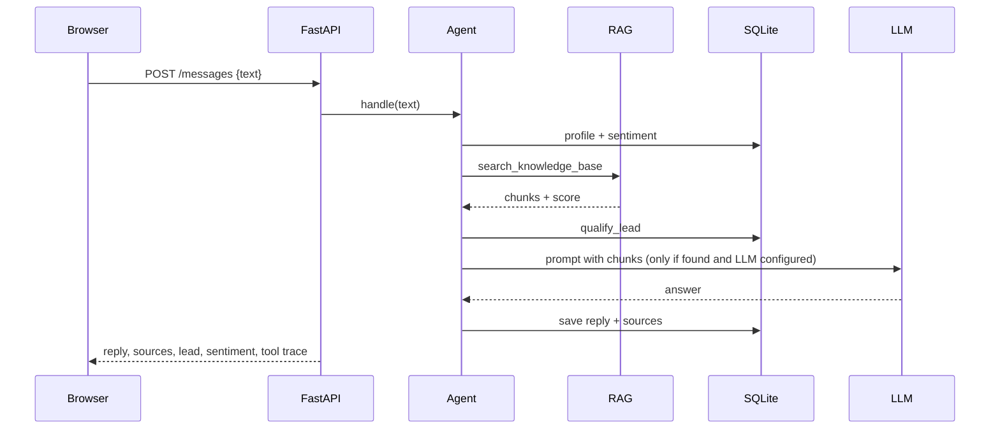

# System architecture

Sources: `docs/diagrams/*.mmd` (Mermaid). Editable draw.io versions: [diagrams/DRAWIO_LINKS.md](diagrams/DRAWIO_LINKS.md).

## Implemented MVP

## Layers

### Frontend (`frontend/`)
- **React 19 + TypeScript + Vite**. Pages are lazy-loaded routes: Overview, Live agent, Leads (CRM), Appointments, Knowledge base, Analytics, Settings.
- **Tailwind CSS v4** with design tokens in `src/index.css` (light + dark), **shadcn/ui-pattern components** in `src/components/ui` (Radix primitives + class-variance-authority), **Lucide** icons, **Recharts** charts, **sonner** toasts.
- `src/lib/api.ts`: typed API client. All calls go to `/api`, which the Vite dev server proxies to `127.0.0.1:8000`, so the browser never needs the backend URL or any secret.
- `src/hooks/useVoice.ts`: STT, TTS, microphone level meter, error mapping, barge-in.

### Voice pipeline
1. `SpeechRecognition` (lang `en-IN` or `hi-IN`) produces interim + final text. In Chrome the audio is sent to Google's speech service, so it needs internet; nothing is stored by Kiln & Signal.
2. Final text is POSTed to `/api/conversations/{id}/messages` with `channel=voice`.
3. The reply is read with `speechSynthesis` using a voice that matches the reply language.
4. Hands-free mode loops listen → send → speak. Clicking the mic while the agent speaks cancels speech (barge-in).
5. Unsupported browser / blocked mic / no speech / network errors show a clear banner and the text box keeps working.

### Inbound telephone pipeline
1. The ExoPhone is assigned to an Exotel App Bazaar flow containing a Voicebot applet.
2. The applet opens the authenticated `/api/telephony/exotel/stream` WSS endpoint. In Docker, Nginx forwards the WebSocket upgrade to FastAPI; the Vite dev proxy also permits WebSockets.
3. The bridge forwards 16 kHz mono linear16 caller audio to Sarvam realtime STT. Final transcripts enter the same SalesAgent and CRM workflow used by browser conversations.
4. Sarvam TTS produces linear16 audio that the bridge streams back to Exotel for playback. Pressing 9 switches English/Hindi; a goodbye closes the conversation and records a summary.
5. This path is implemented in code, but a live call still needs Exotel AgentStream enablement, a number-to-flow assignment, public WSS hosting, Exotel credentials and a Sarvam key. Provider usage may be charged.

### Backend (`backend/app/`)
| File | Responsibility |
|---|---|
| `main.py` | App, CORS, generic 500 handler, startup (create tables, seed KB) |
| `config.py` | Settings from environment / `.env` |
| `models.py` | 13 SQLAlchemy tables |
| `agent/orchestrator.py` | Per-message pipeline: language → extraction → sentiment → intent planner → tools → scoring → reply |
| `agent/tools.py` | The 10 tools, Pydantic input schemas, permission list, execution log |
| `services/rag.py` | Text extraction, chunking, BM25 index, optional embeddings, not-found guard |
| `services/llm.py` | Provider abstraction: Gemini (REST), Ollama (local), demo |
| `services/exotel_stream.py` | Exotel/Sarvam streaming audio bridge for inbound phone calls |
| `routers/telephony.py` | Exotel Basic Auth WebSocket endpoint and shared CRM callbacks |
| `services/extraction.py`, `scoring.py`, `sentiment.py`, `scheduling.py`, `summary.py` | Sales intelligence + calendar |
| `routers/*.py` | REST endpoints |
| `security.py` | Admin key check, rate limiting |

### Agent pipeline

**Design decision:** a rule-based planner chooses the tools and the LLM only writes text. Reasons: works without any API key, deterministic and unit-testable, the LLM can never trigger a booking by itself, and times/IDs in confirmations come straight from the database. Native LLM function calling can be added later because every tool already has a JSON-schema-like Pydantic input model.

### One voice turn

### Database
SQLite through SQLAlchemy ORM; see [DATABASE_DESIGN.md](DATABASE_DESIGN.md). Changing `DATABASE_URL` to PostgreSQL needs no code change except installing a driver.

### Integrations
| Integration | Status |
|---|---|
| Gemini API | Implemented, tested with mocked HTTP |
| Ollama | Implemented, tested with mocked HTTP |
| Google Calendar | Not implemented. `CalendarAdapter` protocol in `scheduling.py` is the seam |
| External CRM | Not implemented. CSV export available |

Production design: [SCALABILITY.md](SCALABILITY.md).
